# World Life Expectancy SQL Analysis

SQL data cleaning and exploratory analysis of world life expectancy data using MySQL.

## Project Overview

This project analyzes world life expectancy data to identify patterns related to economic development, GDP, BMI, mortality, and changes in life expectancy over time.

The project includes two main stages:

1. Data cleaning to identify duplicates and handle missing values.
2. Exploratory data analysis to examine relationships and trends in life expectancy across countries.

## Tools Used

- MySQL
- MySQL Workbench
- SQL
- Visual Studio Code
- GitHub

## Data Cleaning

The data cleaning process included:

- Identifying duplicate country-year records using `ROW_NUMBER()`
- Removing duplicate records
- Checking for missing development status values
- Standardizing missing `Developed` and `Developing` status values
- Identifying missing life expectancy values
- Estimating missing life expectancy values using the average of adjacent years
- Performing a final missing-value check

The complete cleaning queries are available in:

[`sql/data_cleaning.sql`](sql/data_cleaning.sql)

## Exploratory Data Analysis

The exploratory analysis examined:

- Changes in life expectancy by country
- Average global life expectancy by year
- Life expectancy compared with GDP
- Life expectancy differences between high-GDP and low-GDP observations
- Life expectancy by development status
- Number of countries by development status
- Life expectancy compared with BMI
- Rolling adult mortality for countries containing "United"

The complete analysis queries are available in:

[`sql/exploratory_analysis.sql`](sql/exploratory_analysis.sql)

## Key Findings

- Average life expectancy generally increased across the years shown in the dataset, rising from **66.75 in 2007** to **71.54 in 2021**.
- Observations with GDP of **1,500 or higher** had an average life expectancy of approximately **74.2 years**, compared with approximately **64.7 years** for observations with GDP of **1,500 or lower**.
- Developed countries had an average life expectancy of approximately **79.2 years**, compared with **66.8 years** for developing countries.
- The dataset contained **32 developed countries** and **161 developing countries** in the development-status comparison.
- The analysis also showed substantial differences in life expectancy growth between countries over the period examined.

## Project Screenshots

### Duplicate Removal

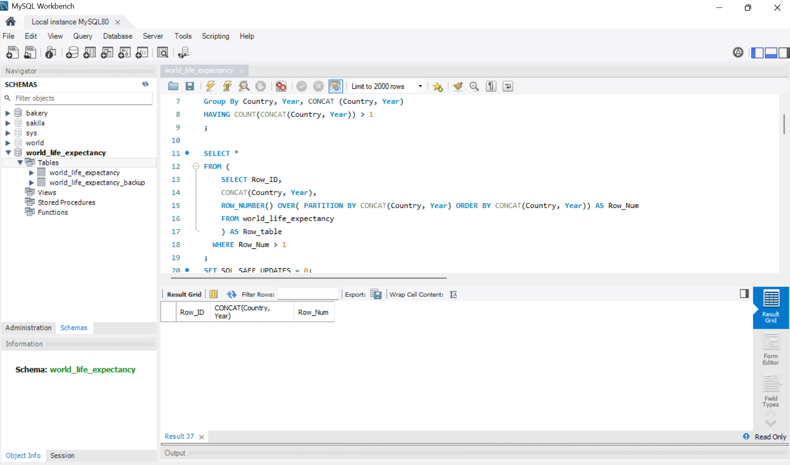

### Missing Status Check

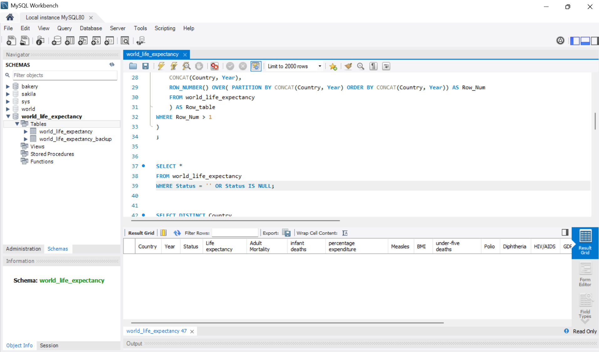

### Life Expectancy Interpolation

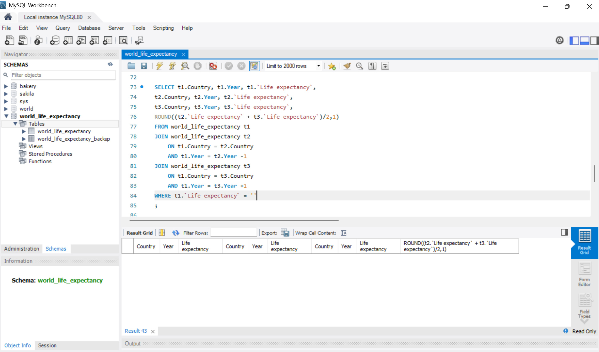

### Life Expectancy Update

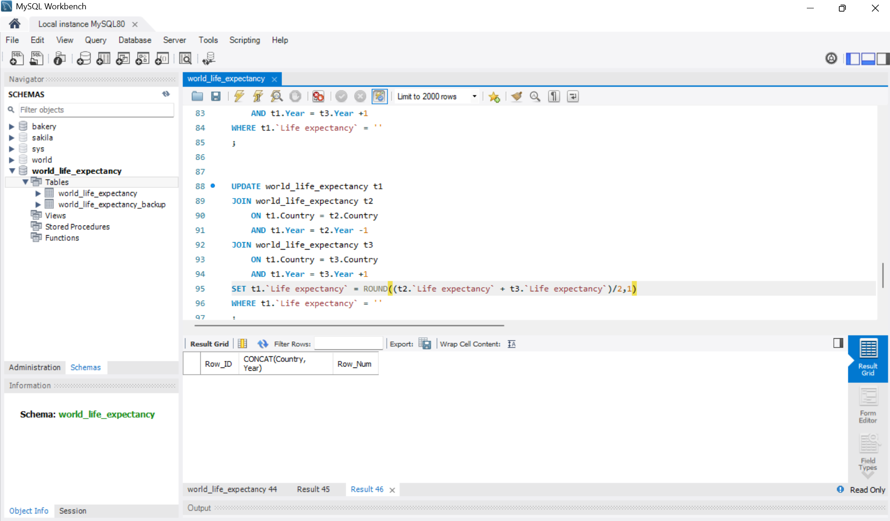

### Final Missing Life Expectancy Check

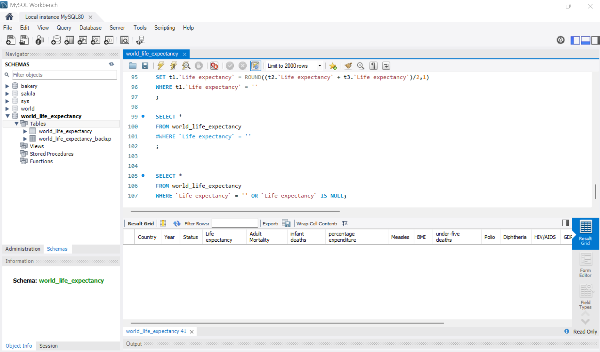

### Life Expectancy Increase by Country

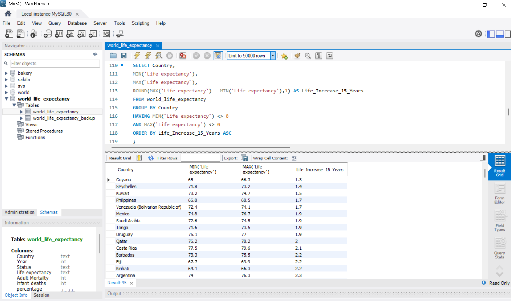

### Average Life Expectancy by Year

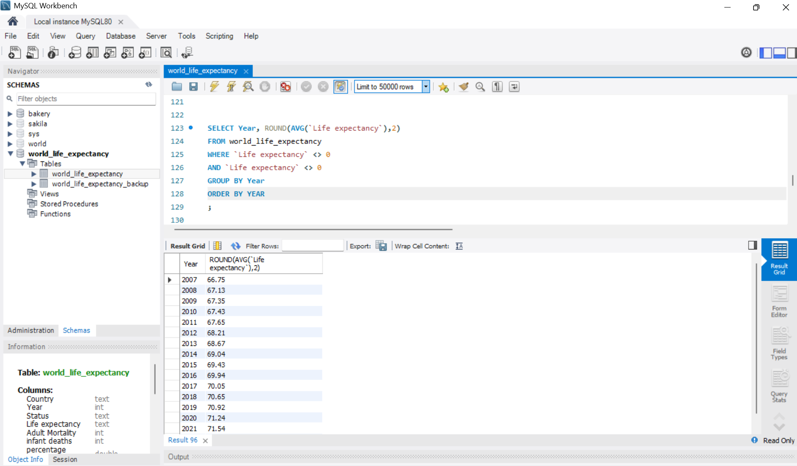

### Life Expectancy vs GDP

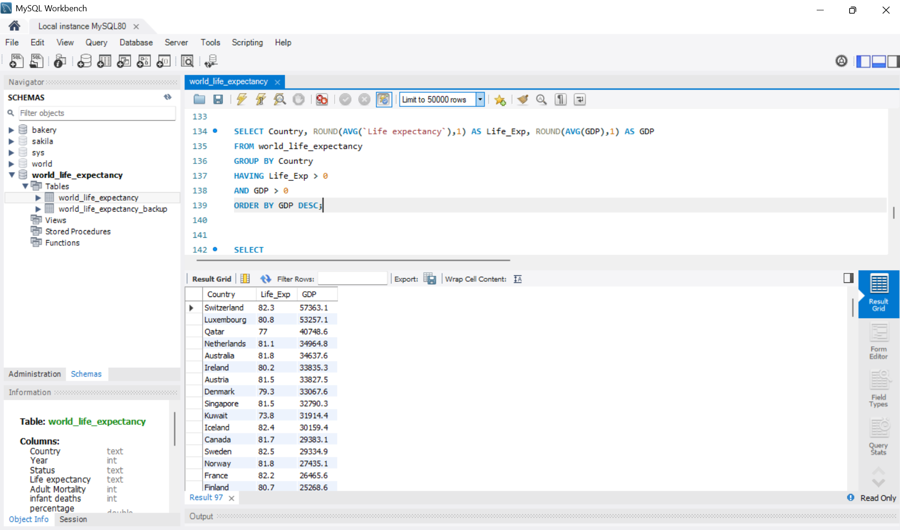

### High vs Low GDP Life Expectancy

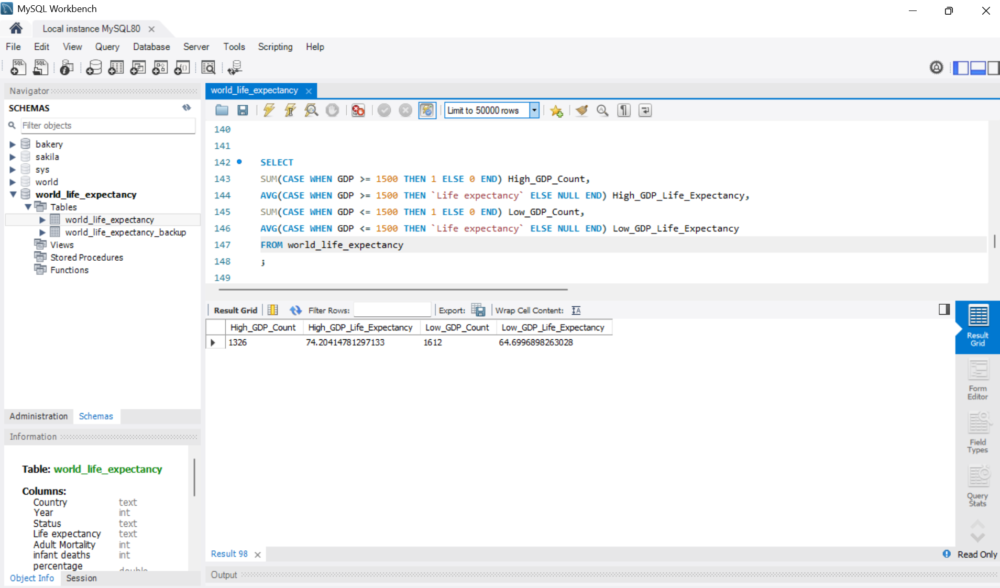

### Life Expectancy by Development Status

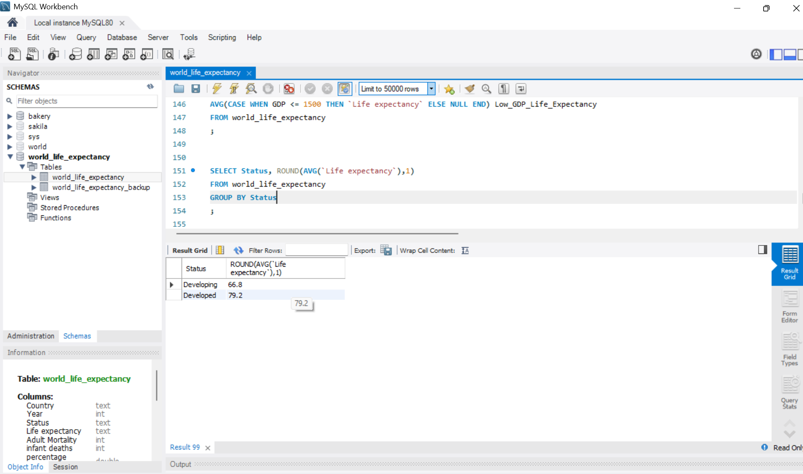

### Development Status Country Counts


### Life Expectancy vs BMI

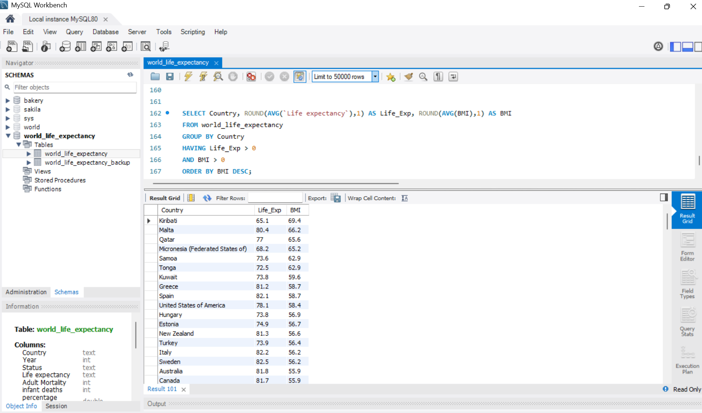

### Rolling Adult Mortality

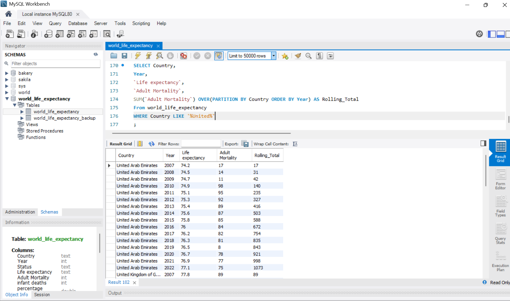

## Repository Structure

```text
world-life-expectancy-sql-analysis/
├── README.md
├── sql/
│   ├── data_cleaning.sql
│   └── exploratory_analysis.sql
└── screenshots/
    ├── 01-duplicates-removed.png
    ├── 02-status-missing-values-check.png
    ├── 03-life-expectancy-interpolation-method.png
    ├── 04-life-expectancy-update-query.png
    ├── 05-life-expectancy-missing-values-check.png
    ├── 06-life-expectancy-increase-by-country.png
    ├── 07-average-life-expectancy-by-year.png
    ├── 08-life-expectancy-vs-gdp.png
    ├── 09-high-vs-low-gdp-life-expectancy.png
    ├── 10-life-expectancy-by-development-status.png
    ├── 11-development-status-country-counts.png
    ├── 12-life-expectancy-vs-bmi.png
    └── 13-rolling-adult-mortality.png
```

## Author

Hamzah  
GitHub: [hamzaha-bot](https://github.com/hamzaha-bot)